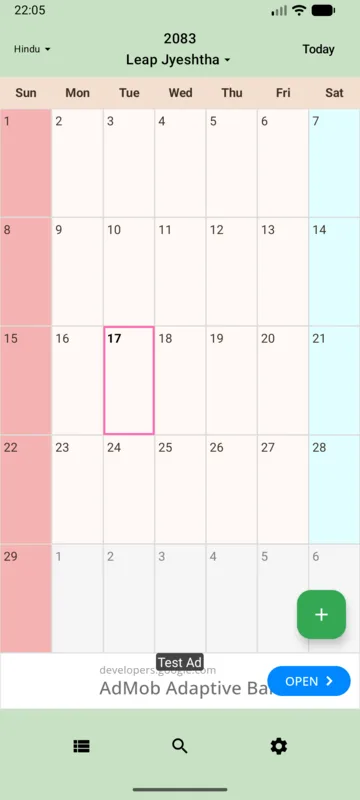

## Overview

India has many solar and lunisolar calendar traditions. This guide describes the app’s Vikram Samvat calendar using the Amanta convention, rather than treating it as a representation of every Indian calendar.

## Where it is used

Amanta is used in parts of India. Other regions use Purnimanta or other systems, with differences in eras, new years, month names and observance rules.

## Historical background

Indian calendars developed through astronomy and regional tradition. Vikram Samvat is one era used for numbering years and should not be confused with the Saka era of India’s national calendar.

## Years, months and days

Amanta months are divided at new moons, while Purnimanta months are divided at full moons. Leap months (adhika) adjust the relationship to the seasonal year; rarely, a month name can also be omitted (kshaya). A tithi is based on the angular separation of the Sun and Moon, rather than a midnight-to-midnight civil day. Traditional Amanta months begin with the bright fortnight after the new moon, and panchang dates commonly use the tithi at sunrise. [Sources: India Meteorological Department — Explanation](https://packolkata.imd.gov.in/panchang/en/explanation); [S. K. Chatterjee — Indian Calendars](https://www.cambridge.org/core/services/aop-cambridge-core/content/view/0661941482297D73847158FD39140765/S0252921100105901a.pdf/indian_calendars.pdf)

## Compared with the Gregorian calendar

Unlike the fixed Gregorian month pattern, month starts and leap months depend on astronomical relationships. Adding or subtracting a year offset does not convert the month and day.

## Date calculation

The app constructs months using approximate new-moon and sidereal-longitude calculations with a Lahiri precession adjustment. The app starts each month at midnight on the Indian Standard Time date on which the new moon occurs. It assigns that date day 1 and counts consecutive day numbers from there. This is an app-specific display convention, distinct from traditional Amanta dates based on tithi and sunrise. The app starts the year with Chaitra.

## Using it in WorldCalendar

Select the Indian lunisolar calendar; current English resources label it Vikram (Amanta). Date display changes at midnight in India time.

<figure><figcaption>An earlier screenshot provided by the developer. Appearance and features vary by version and settings.</figcaption></figure>

## Limitations and important notes

There is no Purnimanta switch or selector covering all regional religious calendars. For festivals or rituals, consult official local guidance or an appropriate panchang.

See [Calendar Help](/helps/en/02-calendars.html#calendar-limits) for detailed instructions and conditions.

## Sources and further reading

- [India Meteorological Department — Explanation (Rashtriya Panchang)](https://packolkata.imd.gov.in/panchang/en/explanation)
- [S. K. Chatterjee — Indian Calendars (PDF)](https://www.cambridge.org/core/services/aop-cambridge-core/content/view/0661941482297D73847158FD39140765/S0252921100105901a.pdf/indian_calendars.pdf)
- [India Meteorological Department — Rashtriya Panchang](https://mausam.imd.gov.in/responsive/rashtriyPanchang.php)
- [India Meteorological Department — Calendar systems (PDF)](https://metnet.imd.gov.in/docs/imdrajbhasha/sangoshthi_2017%28S%29/6891124.pdf)
- [IGNCA digital collection — The Hindu Calendar (PDF)](https://ignca.gov.in/Asi_data/34958.pdf)

These sources describe calendar traditions. App-specific behavior was checked against the Android implementation and existing help. Historical tables and time-sensitive statements in the sources are not reproduced as current data.

## Related guides

- [Gregorian calendar](/en/calendars/gregorian/)
- [Japanese lunisolar calendar (Kyureki)](/en/calendars/japanese-lunar/)
- [All calendar guides](/en/calendars/)

## Try it in the app

Explore six calendars and manage events on Android. [View WorldCalendar on Google Play](https://play.google.com/store/apps/details?id=xyz.takuborn.worldcalendar).
