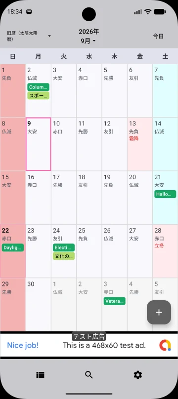
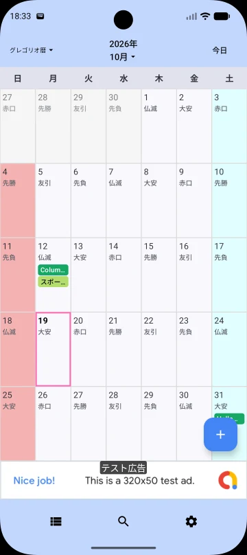

## Overview

Kyureki is a Japanese lunisolar calendar. It combines months based on the lunar cycle with adjustments that keep the year connected to the seasons. Calling it purely lunar misses that seasonal adjustment.

## Where it is used

It is consulted in Japan for historical dates and seasonal traditions. Related East Asian lunisolar calendars share ideas but should not be assumed to produce identical dates.

## Historical background

Strictly, Kyureki refers to the Tenpo calendar used before Japan’s calendar reform. It came into use in 1844; earlier historical dates used other calendar systems. [Source: National Diet Library — 江戸から明治の改暦 (Calendar reforms from Edo to Meiji; in Japanese)](https://www.ndl.go.jp/koyomi/chapter1/s2.html) Modern reconstructions commonly use present-day astronomical calculations of new moons and solar terms rather than fully reproducing historical practice.

## Years, months and days

Months normally contain 29 or 30 days. A year has 12 months, or 13 when a leap month is inserted to limit drift against the seasonal year. A leap month is distinguished from its regular counterpart.

## Compared with the Gregorian calendar

Gregorian month lengths follow arithmetic rules; Kyureki months are anchored to new moons. A recurring Kyureki month and day therefore moves within the Gregorian year.

## Date calculation

The app calculates new moons and solar positions in Japan time. It identifies the winter-solstice month as month 11 and, when there are 13 months between these months, assigns the first month without a principal solar term as the leap month. This is not a claim to reproduce every historical Tenpo rule.

## Using it in WorldCalendar

Select Kyureki from the calendar selector. Dates change at midnight in Japan time. The Kyureki view includes the 24 solar terms and can show Rokuyo when enabled.

### Displaying the 24 solar terms

<figure class="calendar-detail-figure">

<figcaption>The 24 solar terms in the Japanese lunisolar view. Soko (霜降, Frost Descent) and Ritto (立冬, Start of Winter) appear in red. The supplied screenshot uses the Japanese interface.</figcaption></figure>

### Displaying Rokuyo

<figure class="calendar-detail-figure">

<figcaption>Rokuyo display example in the Gregorian view. Rokuyo can be shown in both the Gregorian and Japanese lunisolar calendars. The supplied screenshot uses the Japanese interface.</figcaption></figure>

## Limitations and important notes

In 2033, the astronomical configuration makes it impossible to satisfy all the Tenpo rules for assigning month names at once. No public authority currently decides how modern Kyureki should resolve this case. This is a question of month-assignment rules, rather than simply calculation precision; the app’s method is not a uniquely official Kyureki. [Source: NAOJ — 旧暦2033年問題について (The Kyureki 2033 problem; in Japanese)](https://eco.mtk.nao.ac.jp/koyomi/topics/html/topics2014.html)

Neither agreement with all historical or regional calendars nor accuracy across every date is guaranteed. Check official information for important dates.

See [Calendar Help](/helps/en/02-calendars.html#calendar-limits) for detailed instructions and conditions.

## Sources and further reading

- [国立天文台 — 旧暦2033年問題について](https://eco.mtk.nao.ac.jp/koyomi/topics/html/topics2014.html)
- [National Diet Library — 江戸から明治の改暦 (Calendar reforms from Edo to Meiji; in Japanese)](https://www.ndl.go.jp/koyomi/chapter1/s2.html)
- [国立天文台 — 定気法の影響](https://eco.mtk.nao.ac.jp/koyomi/wiki/C2C0B1A2C2C0CDDBCEF12FC4EAB5A4CBA1A4CEB1C6B6C1.html)

These sources describe calendar traditions. App-specific behavior was checked against the Android implementation and existing help. Historical tables and time-sensitive statements in the sources are not reproduced as current data.

## Related guides

- [Gregorian calendar](/en/calendars/gregorian/)
- [Julian calendar](/en/calendars/julian/)
- [All calendar guides](/en/calendars/)

## Try it in the app

Explore six calendars and manage events on Android. [View WorldCalendar on Google Play](https://play.google.com/store/apps/details?id=xyz.takuborn.worldcalendar).
