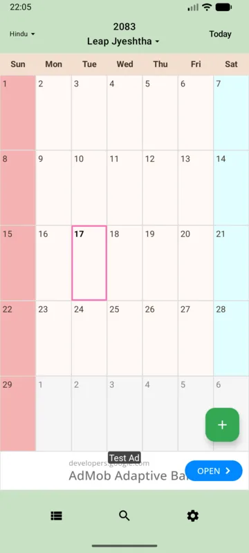

## 暦の概要

インドの暦には太陽暦や太陰太陽暦など多様な方式があります。ここでは、アプリが実装するVikram SamvatのAmanta方式を紹介します。インドのすべての暦を代表するものではありません。

## 主に利用される国や地域

Amantaはインドの一部地域で使われます。一方、Purnimantaなど別の月の区切り方もあり、地域によって紀年、年初、月名、行事の決め方が異なります。

## 歴史的背景

インドの暦法は天文学と地域ごとの慣習の中で発展しました。Vikram Samvatは紀年法の一つです。インド国定暦のSaka紀年と混同せず、どの方式の暦かを確認する必要があります。

## 年・月・日の仕組み

Amantaは新月で月を区切り、Purnimantaは満月で月を区切ります。季節とのずれを調整する閏月（adhika）に加え、まれに月名が一つ欠ける欠月（kshaya）もあります。宗教暦のティティは太陽と月の角度差に基づく単位で、午前0時からの一日とは一致しません。伝統的なAmanta暦では新月後の白分（満月へ向かう半月）から月が始まり、一般的なパンチャンガの日付は日の出時点のティティを基にします。[出典：インド気象局「Explanation」](https://packolkata.imd.gov.in/panchang/en/explanation)、[S. K. Chatterjee「Indian Calendars」](https://www.cambridge.org/core/services/aop-cambridge-core/content/view/0661941482297D73847158FD39140765/S0252921100105901a.pdf/indian_calendars.pdf)

## グレゴリオ暦との違い

グレゴリオ暦の固定的な月構成とは異なり、月の開始や閏月が天文上の関係に依存します。紀年の差だけを加減して、月日まで変換することはできません。

## 日付計算に関する特徴

アプリは新月と恒星黄経、Lahiri歳差補正の近似計算を用いて月を構成します。本アプリは、インド標準時で新月が起きる日を、その日の午前0時から月初として扱います。日番号は月初を1日目とした連続した日番号です。伝統的なAmanta暦のティティや日の出による日付とは異なる、アプリ独自の表示方式です。年初にはChaitraを採用します。

## WorldCalendarでの利用方法

暦の選択からインド太陰太陽暦（Amanta）を選びます。英語UIの現行リソースではVikram (Amanta)と表記されます。日付表示はインド時間の午前0時を基準とします。

<figure><figcaption>提供された過去の画面例です。表示や機能はバージョン・設定によって異なります。</figcaption></figure>

## 注意事項・制限

Purnimantaへの切り替えや、地域ごとの宗教暦を選び分ける機能はありません。祭日や儀礼の日付は地域の公式情報・パンチャンガを確認してください。

詳しい操作と条件は[暦のヘルプ](/helps/ja/02-calendars.html#calendar-limits)をご確認ください。

## 出典・参考資料

- [India Meteorological Department — Explanation (Rashtriya Panchang)](https://packolkata.imd.gov.in/panchang/en/explanation)
- [S. K. Chatterjee — Indian Calendars (PDF)](https://www.cambridge.org/core/services/aop-cambridge-core/content/view/0661941482297D73847158FD39140765/S0252921100105901a.pdf/indian_calendars.pdf)
- [India Meteorological Department — Rashtriya Panchang](https://mausam.imd.gov.in/responsive/rashtriyPanchang.php)
- [India Meteorological Department — Calendar systems (PDF)](https://metnet.imd.gov.in/docs/imdrajbhasha/sangoshthi_2017%28S%29/6891124.pdf)
- [IGNCA digital collection — The Hindu Calendar (PDF)](https://ignca.gov.in/Asi_data/34958.pdf)

一般的な暦法の資料です。アプリ固有の方式はAndroid実装と既存ヘルプを照合しています。資料内の歴史的な日付表や「現在」の年を、そのまま最新情報として転載していません。

## 関連記事

- [グレゴリオ暦](/calendars/gregorian/)
- [日本の旧暦](/calendars/japanese-lunar/)
- [世界の暦の一覧](/calendars/)

## アプリで使ってみる

6種類の暦と予定管理をAndroidで。[Google PlayでWorldCalendarを見る](https://play.google.com/store/apps/details?id=xyz.takuborn.worldcalendar)。
